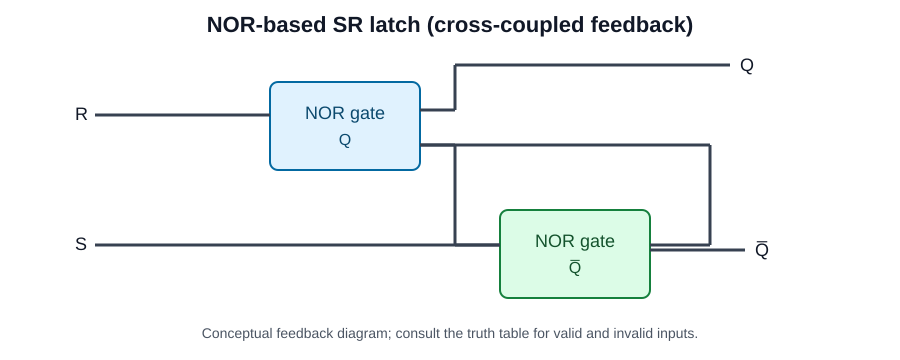

# Circuit diagrams

The SVG illustrates the cross-coupled NOR feedback principle used to store one bit. It is a conceptual learning diagram, not a Vivado-generated netlist schematic.

For other designs, open the RTL in Vivado and use **Open Elaborated Design → Schematic** (or the synthesized schematic) to capture the implementation. Add exported images here with descriptive filenames.
