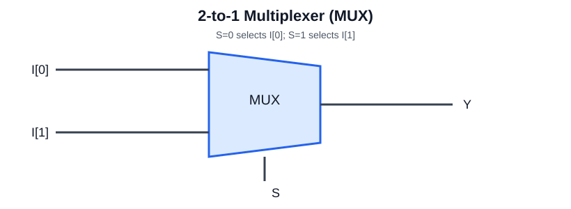

# Circuit diagrams

## 2-to-1 multiplexer

For a 2:1 MUX, select S=0 routes I[0] to Y; S=1 routes I[1] to Y.

## NOR SR latch

The SR latch illustration shows the cross-coupled NOR feedback principle used to store one bit. These SVGs are conceptual learning diagrams, not Vivado-generated netlist schematics.

For implementation schematics, open the RTL in Vivado and use **Open Elaborated Design → Schematic** (or the synthesized schematic) to capture the implementation. Add exported images here with descriptive filenames.
